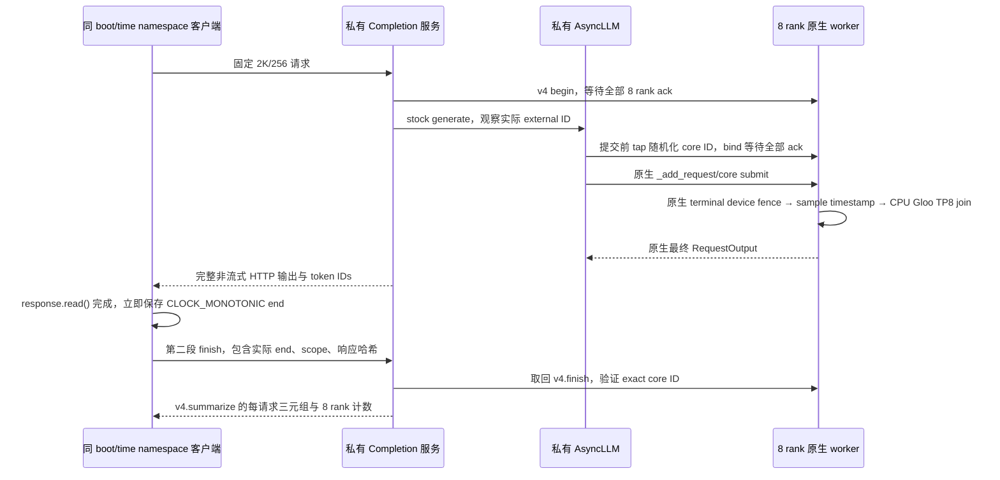

# DSpark API 真实计数桥：CPU 准备包

本包已完成私有 HTTP service/client 的源码接线及 CPU 协议验证。当前 NPU 权限为 0：未启动服务，未发送真实 HTTP 推理，未调用 NPU。实际 API 性能、实际客户端质量、device consumer proof、性能收据和正式收据均为 false。

`stock_compat_v4/formal_dspark_counters.py` 原文件与算法保持不变，SHA256 为 `da845a5891557f21e80eac06d96aec1955263d1ae93afbc4d84e86dd9585dbec`。新的 worker 继承原 `FormalDSparkWorker`，只增加 describe/begin/bind/finish RPC；AsyncLLM 使用私有子类，无官方全局 monkey patch。旧 serve/client/bench/launcher、SDK/model、其他冻结包、根 STATUS/MANIFEST 均未修改。

私有入口只允许 `GET /private/dspark/identity`、`POST /private/dspark/completions` 和 `POST /private/dspark/finish`。所有公开推理、管理和 WebSocket 入口由外层 ASGI 白名单拒绝。单个 window 未 finish 就拒绝下一请求；abort、断开、部分输出或 RPC 验证失败后保留失败证据并锁定实例，不自动重试。

`completion` 请求只有一个 2048 项 token-ID prompt，固定 n=1、stream=false、echo=false、max/min_tokens=256、ignore_eos=true、add_special_tokens=false、return_token_ids=true、temperature=0。body.request_id 必须与 X-Request-Id 相同。stock 的真实 `_base_request_id` 位于 `entrypoints/serve/engine/serving.py`，header 优先级已取证；实际 external engine ID 从 generate 入参观察，随机化 core ID 从 `_add_request` 入参观察，后续不再读取会被 finish/abort 删除的 OutputProcessor map。



begin 和 finish 都比较客户端、服务和 8 rank 的 `CLOCK_MONOTONIC + boot_id + time_namespace`。客户端必须在同一 scope 中运行；不使用本机跨机 HTTP 时钟与 a3 单调钟相减，也不夹钟。finish RPC 与 JSON 解析/文件写入均发生在保存真实 HTTP read-end 之后，finish RPC 不进入 decode 时间。

v4 的 `decoded_tokens=len(final_tokens)-1` 定义直接复用。HTTP 返回 256 个输出 token，其中首个 prefill seed 被排除，decode 为 255；每请求 rounds 来自原生 target/verifier 的实际计数。聚合仅使用至少 8 个串行测量 window，按 `sum(decode_elapsed)/sum(rounds)` 得出自洽 `(ms/step, A, tok/s)`；至少 2 个 warmup 独立保留，不进入聚合。HTTP usage 与实际 RequestOutput/返回的 prompt/output token IDs 要同时满足 2048/256。

`prepare_workload.py` 可在后续 CPU 窗口用真实 tokenizer 和真实小说切片冻结至少 8 个不同的可答任务 prompt；本轮尚未准备或运行真实 prompt 集。`quality_cpu.py` 复用仓库非重叠 40 字窗口的复读规则，并报告 token 窗口复读、空答与乱码指纹。clean/repetition 是文本洁净度启发式，不授语义准确率、GSM8K 或 vision 通过。真实运行完成后 client 才可记录 API 观测与 clean-rate；性能及正式收据仍需外部真实审查，bridge 不自动授予。

CPU 验证为 21 项测试、90 个拒绝反例、0 个未处理异步异常。16 个安装源码文件有完整 SHA 和选定函数片段；9 个真实函数用 AST 执行，包括随机化、原生提交、finish 删除映射、三段 collective RPC 和断开处理。冻结 v4 install_runner 在 8 个明确的 CPU fake runner 上执行，终末 fence/Gloo 都是 mock；rank7 延迟用于验证所有 rank 的 fence/timestamp/join entry 都先于模拟 HTTP 输出。正常 CPU 序列有独立 2 warmup + 8 measured。

另有真实 tiny 失败原始记录的协议输入：2044 token 首段 sampled=[]，4 token 后段 sampled=[87930]，随后 128 decode、130 原始 helper 调用、256 输出。CPU 重放验证首个空 sample 没有 seed/start，第二段才产生唯一 seed；计 128 decode rounds 与 255 decode token，CPU mock 的 130 次 `_propose` 不参与 rounds。原 tiny 是失败、dummy period2，未获 tiny/formal admission；其 token 复读在本包 CPU quality 中也失败。此记录只验证 v4 对拆分 prefill 的兼容性，不能外推正式模型的拆分、图、消费者或性能。

主要文件：

- `runtime_guards.py`：精确 v4 SHA/模块别名与真实 clock scope 守卫。
- `worker_rpc.py`、`worker_adapter.py`：新私有 worker RPC 与原 worker 继承。
- `async_adapter.py`、`bridge_state.py`：实际 request-ID tap、8 rank bind、单 window 状态与证据。
- `http_isolation.py`、`service_bootstrap.py`：私有 HTTP 接线；bootstrap 默认只写 CPU plan。
- `acceptance_client.py`、`prepare_workload.py`、`quality_cpu.py`：真实同 scope client 的准备源码。
- `evidence/installed_source_guards.json`：安装 API ABI 的只读源码证据。
- `evidence/tiny_two_prefill_protocol_input.json`：只读 tiny 失败记录的 CPU 输入与出处。
- `evidence/cpu_validation.json`、`cpu_validation.log`：CPU 验证与 happens-before 证据。

本地只运行 CPU 验证：

```bash
cd experiments/operator_stack
PYTHONDONTWRITEBYTECODE=1 python3 -m parallel_tiny.dspark_api_counter_bridge_cpu.verify_bridge_cpu
```

后续新 TP8 分配窗口中才能使用 bootstrap 的 `--execute` 和 client 的 `--execute`。代码须放在新 snapshot 的 `parallel_tiny/dspark_api_counter_bridge_cpu/`，保留原 `dspark_formal_prep`、冻结计数器及 graph observer 依赖；counter-file 显式指向 SHA 相符的 v4。默认的 dry-run 不导入 vLLM/torch、不起服务、不发 HTTP。没有复用拒绝 DSpark 且固定 A=1 的旧 `serve_formal_tp8.py` / `run_formal_client_acceptance.py`。
