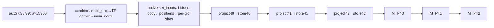

# 原位context组件graph接线：CPU候选

最小后续上机候选是**只给KV前置helper提供一个prepared组件entry**，combine继续原native，三个MTP block继续串行native。`context_adapter_factory_cpu.py`返回两份原签名callable，不安装model hook、不创建NPUGraph；默认binding/entry为空，所以完全调用bound native。root在SDK/actual consumer门后可接入真正prepared backend。若要完整覆盖combine，则在其原调用点再加独立entry；不能把combine移到set_inputs之后，或跨过metadata/input copy拼成一个graph。

实际函数路径为`AscendSpecDecodeBaseProposer._propose`第900行调用combine；`AscendDSparkProposer.set_inputs_first_pass`复制combined hidden到`_dflash_hidden_states`，按每个attention group生成context/query slots；`_run_merged_draft`第1262行调用继承的`AscendDflashProposer.build_model_inputs_first_pass`，后者第304行调用native `precompute_and_store_context_kv`。native loop逐层执行wkv→kv_norm→split448/64→RoPE→cat/contiguous→slot format→ScatterSk，三次store都在第1276行draft forward之前。V41 forward保留hidden/pre_mix的MTP40→41→42依赖和最终hc_collapse；不能把三个MTP block并行。

source消费链也已绑定：V41 Decoder.forward调用该layer.self_attn；V4 Attention.forward委托AscendDeepseekSparseAttention，后者保留同一个`dsa_modules.swa_cache_layer`，通过`dsa_forward` custom op读取static_forward_context中的layer，`_build_kv_cache`从同一`self.swa_cache_layer.kv_cache`组成cache tuple并传给impl.forward。这是源码引用一致性，尚不是cache写入后的实际device消费证明。entry/pool owner未来还须持有proposer、query slot/block-table及per-layer metadata对象，不能只持有helper的context-slot参数。

当前正式eager/profile的全部8rank bank均`draft_use_cuda_graph=false`、`draft_graph_configured=false`，无实际helper capture receipt。源码base第612行可用ACLGraphWrapper包整个`_run_merged_draft`；**若未来启用该outer graph，KV hook本来就在outer body内**，组件adapter应直接交回native hook，禁止嵌套NPUGraph或在outer capture中replay另一entry。combine始终在该runnable外。graph wrapper还包含offloader stream sync/join；profile所见stream47不能证明TP allgather或其他内部stream已经可capture，因此combine entry需单独的collective/stream SDK门。

| 输入/输出 | 当前证据 |
|---|---|
| aux | step9 BF16 `[6,15360]`；actual producer GM/stride/epoch未绑定 |
| main_proj本rank | BF16权重`[640,15360]`、输出`[6,640]`；native TP gather后5120宽 |
| combined/context | native main_norm后`[6,5120]`；`_dflash_hidden_states`持久buffer切片 |
| context positions | 原per-group inputs kernel写`_context_positions_buffer[:6]`，不能改用query positions |
| 每层KV | native wkv/kv_norm、448/64 split/RoPE/cat，最终BF16 `[6,1,512]` |
| slots | 每gid原context buffer平面`[6]`；按cache layer block_size格式化为INT32 `[6,2]` |
| cache | bank观测BF16 `[7939,128,1,512]`；actual live gid、owner epoch、alias子域未知 |
| query/MTP | K5 anchor query为5，与context extent6分别绑定 |

实际A3 profile是`ScatterNdUpdateSk`：cache BF16＋INT32 `[6,2]`＋BF16 `[6,1,512]`。不能套A5 SparseFlashMla的INT64 scatter分支。保留native `get_dsa_attn_kv_plan`选择、format、wkv quant method和RoPE注册表；不引入新dtype转换、不折叠norm/rope、不重排三组store。

绑定必须从实际`attn_layer_names→name_to_gid→_layer_group_idx`和`_context_slot_mapping_buffers`取得，不能从layer40/41/42、bank ptr或排序猜gid。三个layer可共用同一个gid及其slot buffer；每层仍分别持有native cache view。bank中draft cache ptr还与多个main cache条目相同，这只能说明元数据alias，需要真实allocation/subrange/slot和consumer验证，不能认定语义冲突或隔离已经成立。kernel logical block_size和cache store block_size需分别绑定，不能拿KV manager的physical page size替代。

entry key覆盖所有Tensor的GM/extent/shape/stride/dtype/owner epoch、每layer的name/gid/slots/cache、model/weights与RoPE epoch、KV plan、source SHA、borrowed device/context/stream身份和context/query extent。**profiler Stream ID 47不是aclrtStream handle**，不能拿该数字作为runtime绑定；当前module的这些身份默认None，只在CPU fixture使用明确FAKE标识。factory保留实际args、native bound model和entry/pool owner的强引用；combine output持有至native context copy完成，KV owners持有至MTP42消费完成，writer-stop不等于consumer-stop。更新输入/slot、重新绑定或释放entry必须在对应completion后进行；不能在capture内做D2H、seal或创建新的instance cache。

prefill、ctx extent0/1/5/7/2048、query非5、缺真实group绑定、旧source或owner、未join producer stream、未验证cache alias、SDK/consumer门缺失或没有既有entry时，adapter在任何组件写入之前回原native。没有production首次调用自动capture。prepared调用发生异常可能已经写cache：必须停止后续MTP并保留poisoned lease，不自动重跑native。CPU snapshot恢复只证明模拟ledger可恢复；真实device cache preimage、恢复API与健康/完成状态需另门，当前没有device rollback支持。

`verify_context_wiring_cpu.py`执行冻结原helper、slot-format/scatter和V41 forward函数AST，使用明确CPU stubs验证原算子顺序、形状、group identity、27个admission反例、共享gid、in-flight refresh/release、writer-only release、partial-write停止及adapter强引用。它不计算原生浮点结果，也不证明ScatterSk sentinel/capture、缓存写后消费或收益。`context_source_guards.json`列出的actual gid/slot GM和值、live epoch、WKV workspace、RoPE pool、internal stream和actual consumer仍全部是后续SDK/设备门的输入缺项。
