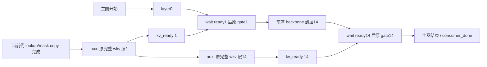

保留原完整 MatMul 的提前/旁路投影方案：只读设计与 CPU 生命周期契约，尚未实现模型补丁、运行新 NPU 或取得性能结论。8 输出片候选继续 reject，原 1 ULP 门不变。

投影可以在模型主图调用之前提交，因为层 1/14 的 wkv 输入只依赖 lookup，不依赖进入该层的 residual。每层继续调用原 `layer.engram.wkv(lookup[:M])`，完整权重 `[25600,6144]`、输出宽度 25600、K=6144、BF16 dtype/format/stride 均不变；两层仍各算一次，每个 TP rank 的复制计算也仍存在。这个候选改变调度位置，收益须靠未来原生 A/A、原精度门与正式客户端配对证明。

准确源码位置：production `worker/model_runner_v1.py:2987` 获取 `prepare_engram_inputs`，`:2989` 用 `(input_ids,positions,num_tokens_padded)` 调用并更新 `model_inputs`，`:2990` 才创建 `run_model`。`models/deepseek_v41/model.py:1356` 的准备函数先执行 `prepare_engram`，再清零/复制持久 mask 和 `_engram_input_buffers[layer]`，最终返回持久 Tensor。`model.py:1469` 的原消费者计算 wkv，再 split `[20480,5120]`、reshape key 到 `[M,4,5120]` 并调用原 gate。源码快照与行号见 [production model](evidence/model_consumer_source.txt)，调用点和 SDK Event 源码另见 [production 调用点 / Event](evidence/full_projection_production_source.txt)。

lookup 的 device-ready 时点是准备函数最后一笔 lookup/mask/padding copy 在其提交流上完成之后。Python 返回只说明这些工作已经提交。应在全部 copy 之后、同一 producer stream 上 record `lookup_written`；aux stream 在捕获外先 wait 此事件，再重放完整投影图。这样 aux 等待的是当前代数据，不能仅因为 Python 函数已返回就读持久 buffer。

这里的 M 必须是实际主图 bucket 的 `num_tokens_padded`，并与主图 `hidden_states.shape[0]` 一致，不能拿持久 buffer 总容量 `_engram_max_tokens` 做投影，也不能拿有效请求 token 数代替图 padding 数。持久 buffer 可以有更大容量，但只投影原消费者会读的 `[:M]`。首个原型限 M=1 decode；prefill、profile、其他 M、pointer mismatch 和未捕获 bucket 走原生路径，各自使用独立 capture identity。

SDK 实际提供两种事件：普通 `Event` 固定 `graph_external=False`；`torch_npu.npu.ExternalEvent` 固定 `graph_external=True`，源码写明可 wait-before-record，捕获时成为 external event node，复用前需 `reset()`，且 reset 前必须等待旧 stream 任务完成。不能把普通 Event 的一次外部 record 塞进主图后，假定每次 replay 都等到新代数据；也不能遗漏 ExternalEvent reset 让下一代 wait 直接通过上一代的 sticky ready。

建议的提交关系是：每个 `(TP rank,bucket,slot)` 缓存一张 aux 投影图，持有两层完整 wkv 输出 Tensor 与两个 ExternalEvent `kv_ready[1/14]`。两个 wkv 在独立 aux stream 串行提交，每层输出写入其持久 Tensor 后 record 对应 ready。runner 先提交 aux 图，再调用主图；主图可先执行 embedding/layer0，到层 1 gate 前 wait `kv_ready[1]`，到层 14 gate 前 wait `kv_ready[14]`。wait 必须作为图引擎能保留的有序节点表达，不能靠普通 Python wrapper 或被优化掉的恒等 Tensor 返回。后续 gate 保留原算式、q/k 权重、rotation、mask 和 eps。

主图的新 Tensor 接口可以是静态 `engram_full_kv={1:kv1,14:kv14}`；CPU event registry 不直接作为 Dynamo 的动态 Python 输入。两层输出地址在 aux capture 时创建并由 cache 持有，主 capture 绑定同一地址；若必须额外 copy 到预分配 kv buffer，ready record 要在该 copy 之后。consumer 切换时只替换 `kv=layer.engram.wkv(lookup)` 的来源，原 key/value split、key view 和 gate 保持。CausalLM 包装层与 backbone 都须显式转发该 Tensor 输入。原生与旁路模式使用不同 graph identity，不能沿用已经捕获原 wkv 的旧图并误以为它已经旁路。

CPU ticket 固定包含 `generation,slot,bucket_M,actual_tokens,lookup_ptrs,mask_ptr,kv_ptrs,weight_version,ready_event_ids,graph_identity`。只有 metadata，CPU ticket 的“已提交”不代表设备完成。全部 Tensor/event 都绑定相同 ticket，旧 ready、其他 bucket、其他 slot 或旧 weight version 不能被当前 gate 消费。

纯 CPU reference ledger 在 [prefetch_lifecycle_contract.py](prefetch_lifecycle_contract.py)：`GraphIdentity` 固定 slot/bucket/地址/weight/event/graph 身份，`Ticket` 增加 generation 与实际 token 数，`SlotLedger` 按 `acquire → arm → publish_lookup → submit_producer → bind_consumer → observe_done → retire` 约束阶段。14 个 CPU 自检全部通过，包括双代复用，以及未清 sticky ready、提前覆写/reset、producer/consumer 只完成一个、旧 generation、错 KV/weight identity、漏层14 ready、未提交 producer 就绑定 main、错 M 和 N 切片的拒绝；结果见 [CPU selfcheck](evidence/cpu_lifecycle_selfcheck.json)。它不 import torch，不验证真实事件完成、SDK reset、capture 或 stream 语义；`ready_flags_clear` 与 `observe_done` 参数必须由真实适配层的观测提供，不能因 enqueue 成功就填 True。

| 生命周期 | 必要条件 / 设备依赖 |
| --- | --- |
| acquire slot | 上一代 producer 与 consumer 的完成 fence 已观察完成；否则等待该 slot 或使用另一个已捕获的空闲 slot |
| reset ready | 旧 ExternalEvent 的 record/wait 任务已完成，再 reset 两个 ready；禁止有旧 waiter 时 reset |
| lookup 写入 | slot 已获得覆写许可，再执行原 prepare 的 zero/copy；结束后 record 当前代 lookup_written |
| aux 投影提交 | aux 在捕获外 wait lookup_written；输入 shape/地址与捕获 identity 相同；仍执行完整 N=25600/K=6144 MatMul |
| kv 发布 | 输出 Tensor 稳定且当前代写入完成之后，各 record kv_ready；CPU 确认 producer 已成功提交才绑定主图 |
| gate 消费 | 当前代 gate 在其原层位置 wait 对应 ExternalEvent，然后消费当前代 kv 和 mask；不复用上一代结果 |
| retire slot | 主图结束后 record consumer_done；上一代 lookup/kv/mask 和 ready 在实际 fence 完成前不能覆写/reset |

保护范围必须完整：lookup 直到 aux 完成两层读取；mask 直到两层 gate 消费完；kv 直到原 gate 及 residual 写回完成；ExternalEvent 直到旧 record/wait 任务完成；input IDs/positions/page metadata 至少直到原 lookup 工作完成。第一版用一个保守的联合 slot fence 覆盖 producer_done 与主图 consumer_done，不提前按“gate 已提交”释放。`query()` 只能用于捕获外检查实际完成；若确需等待，获取 slot 的等待应发生在当前步 device_metadata submit 之前，不在 capture 区间插入全设备 synchronize，也不打断原 submit/release 配对。

单 slot 必须完成上一代后才能 reset/reuse。双 slot 允许代际交错，但每个 slot 都要单独捕获 aux/主图、保有不同 kv 地址与事件，不能仅按 generation 奇偶更换指针而重放同一地址绑定的旧图。若当前 ticket/bucket/地址不匹配，必须在主图提交前选择完整原生路径；不能主图已经等 external ready 后再决定不提交 producer。涉及 ENPU 的 `_update_full_graph_params_if_needed` 保留原调用次序，不能凭 ExternalEvent 的接口存在就改 soft segmentation 的 record-before-wait 约束。

两层实际 consumer 证据应在下一次独立正式 Engram audit 增加，不插入正在运行的 QKV performance。观测位置就是 `model.py:1469` 的原消费者：在 `kv=...wkv(lookup)` 前，保存当前层 `lookup[:M]`、`active_mask[:M]` 与尚未被 gate 改写的 `hidden_states[:M]`；在 wkv 后保存完整 kv；在原 gate/residual 写回后保存输出。两层分别保存，不能把层 1 embedding 或合成 residual 当成层 14 的真实输入。

capture 内只向专用、预分配、地址固定的 audit Tensor 做有界 copy，不 `.cpu()`、`.item()`、序列化、日志或预算计数。预算、请求/step generation、实际 decode 识别由 runner 的图外控制维护，避免 profile/capture 消耗样本。完成这一步的 fence 后，由原审计使用的图外 `_propose`/worker RPC 窗口导出这些专用 buffer；导出前必须阻止下一代覆盖当前样本，不能只凭 Python 回调发生就猜测设备完成。该 audit buffer 是观测用独立副本，不改生产 lookup/residual，也不复用旁路 slot 的生命周期字段。

每份样本标明 `rank,layer,request_id,step_generation,positions,bucket_M,mask,weight_version,weight_format` 和 checkpoint/source hash。先采基线的真实层 1/14，再同实例候选读取相同输入，检查原完整 kv、key/value、gate 与原正式 routes/logits 门；至少 rank0 两层实激活供单片驻留精度重放，同时保留所有 rank 的 lookup/mask 摘要与必要小样本以核对 rank 一致性。原大权重与激活 `.pt` 留远端，只拉 compact SHA/shape/比较摘要；不会把 >1MB 样本经 SSH 拉回。

后续资源批准后的最小验证顺序是同实例原生 A/A → 单代完整投影提前的原精度门 → 两代交错、同 slot 复用与 ExternalEvent reset 的精度/生命周期验证 → 使用上述真实 residual/消费者样本的图重放 → 无审计性能配对。该设计未通过这些验证。主线程当前只收到设计与源码证据，不应据此宣称正式吞吐提升。
